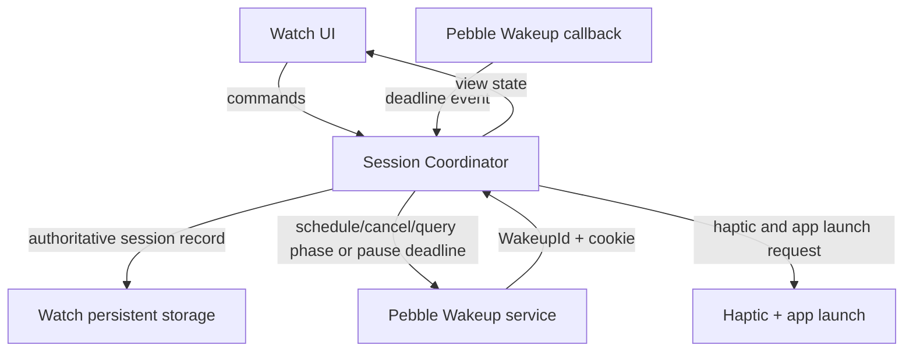

# Architecture Spine — Sit Stand Go — Pebble Time 2

## Design Paradigm

An event-driven state machine in one native Pebble C watch app. One session coordinator owns session and phase state. User actions and Pebble Wakeup events enter through that coordinator; the display renders coordinator state and sends commands, but never owns or advances time.

## Invariants & Rules

### AD-1 — One session-state owner [ADOPTED]

- **Binds:** FR-1–FR-7, UJ-1–UJ-2
- **Prevents:** UI, wakeup handling, or persistence code independently deciding which phase is active.
- **Rule:** The session coordinator is the only writer of lifecycle state, active phase, and phase deadline. All user actions, wakeup callbacks, app launches, and resume/recovery events are serialized through it.

### AD-2 — Deadline-driven time [ADOPTED]

- **Binds:** FR-2, FR-4–FR-7
- **Prevents:** Drift between a ticking countdown, scheduled wakeups, and persisted session state.
- **Rule:** Persist UTC epoch deadlines. Derive remaining time for display from the current UTC epoch and the stored deadline. Timezone or daylight-saving changes do not alter elapsed phase duration. Manual Pause stores remaining phase duration and has no Wakeup; manual Resume creates a phase deadline from current UTC plus saved remaining duration. Timed Pause stores that phase remaining duration plus a separate UTC pause-end deadline. At pause end, resume the same Phase and set its new phase deadline to current UTC plus saved remaining duration. All competing command/deadline events obey AD-10.

### AD-3 — Wakeup events drive background transitions [ADOPTED; target verification required]

- **Binds:** FR-2, FR-3, FR-5–FR-7
- **Prevents:** Depending on the display being foregrounded or maintaining a continuously running process for each phase timer.
- **Rule:** Use the Pebble Wakeup API to schedule the next phase deadline; the coordinator is the only scheduler client. Set `notify_if_missed = false`; app recovery owns phase reconciliation and its single current-phase haptic. Apply AD-11's schedule/commit ordering, generation cookie, stale-callback checks, and recovery protocol. Establish pinned, reproducible toolchain/build readiness before implementation; verify Wakeup support and notification behavior on target Pebble Time 2 firmware with the finished app at the pre-release Story 1.8 gate.

- **Operational boundary:** The user requires the timer to continue when they leave the app; continued operation after explicitly terminating the app is not required. Verify the leave-app behavior on device.

### AD-4 — Reconcile missed deadlines without replaying stale reminders [ADOPTED]

- **Binds:** FR-2, FR-3, FR-5, FR-7, UJ-1–UJ-2
- **Prevents:** A stale phase display or a burst of old notifications after device shutdown or delayed wakeup.
- **Rule:** At recovery when a running phase deadline is due (`now >= phase_deadline`), including one late phase deadline, process elapsed phases in order and rebase the resulting current phase to its full default duration from recovery time. A timed-pause deadline is not a phase deadline; recover it under AD-12/AD-16 by resuming the interrupted phase with saved remaining duration and no Cycle advancement. An on-time phase callback advances sequentially from its expired deadline. Emit at most one haptic for the resulting current phase; never replay stale haptics.

### AD-5 — Watch owns runtime behavior [ADOPTED]

- **Binds:** FR-1–FR-7
- **Prevents:** Session state diverging between the watch, phone, and a cloud service.
- **Rule:** The watch app alone owns runtime session state, transitions, wakeup scheduling, and phase notifications. A phone process or network service is not required during a session.

### AD-6 — Phase and control semantics remain product-defined [ADOPTED]

- **Binds:** FR-1–FR-2, FR-4–FR-7
- **Prevents:** Different implementations choosing different cycle lengths or interpreting pause, skip, extend, and restart differently.
- **Rule:** V1 uses fixed default durations: Sit 45 minutes, Stand 10 minutes, Move 5 minutes; extension adds user-selected time only to the active Phase and does not change defaults. The user may Start at any wall-clock time; the first Sit phase begins immediately at Start and the cycle is relative to that moment, never aligned to full-hour boundaries. Stopping makes it inactive and non-resumable. Manual Pause preserves phase and remaining duration without a deadline; timed Pause preserves phase and remaining duration while a separate 5/10/30-minute pause deadline runs. On timed-pause end, resume the same Phase; do not advance the Cycle. Skip enters the next Phase immediately at its default duration without carrying remaining time forward. Extend moves the active Phase deadline by the selected duration.

### AD-7 — Haptic alerts and app UI have separate responsibilities [ADOPTED]

- **Binds:** FR-3, FR-5, UJ-1–UJ-2
- **Prevents:** Treating a haptic pulse as a readable notification payload or maintaining competing sources for phase text.
- **Rule:** At a phase deadline or timed-pause end, request one Pebble haptic and app launch/open. At timed-pause end, display the resumed (interrupted) Phase and remaining time, with no phase advancement. The opened app UI displays readable state; haptic is not a text notification. After overdue recovery, request one haptic for the resulting current Phase only. Verify haptic and foreground behavior on Pebble Time 2.

### AD-8 — Preserve reminder-only scope [ADOPTED]

- **Binds:** FR-1–FR-7, all v1 implementation units
- **Prevents:** Unrequested sensor, health, analytics, schedule, cloud, or social features entering the architecture through adjacent implementation work.
- **Rule:** V1 is a user-started reminder utility. Do not add posture/step/movement sensing, health claims, history/adherence analytics or telemetry, automatic work-hour/overnight schedules, social features, cloud services, or a runtime phone companion.

### AD-9 — Canonical session record and single mutation boundary

- **Binds:** FR-1–FR-7, UJ-1–UJ-2
- **Prevents:** Storage, UI, and wakeup handling using incompatible representations of session state or writing it independently.
- **Rule:** The Session Coordinator is the only public mutation boundary. The persisted record is private to the coordinator/store and contains schema version, lifecycle (`inactive`, `running`, `paused`, `timed_paused`), positive 31-bit generation, active phase ID, last haptic-attempt generation, and state-specific timing. `running` stores UTC phase deadline and `WakeupId`; `paused` stores positive remaining phase duration and no deadline/WakeupId; `timed_paused` stores positive remaining phase duration, UTC pause-end deadline, and `WakeupId`; `inactive` stores no phase or deadlines/WakeupId. The Wakeup adapter reports event ID/cookie/timestamp only; it cannot mutate the record. Invalid/unsupported schema is inactive with recoverable error; never infer active state from a partial record.

### AD-10 — Serialize and reconcile before every command

- **Binds:** FR-1–FR-7
- **Prevents:** Different outcomes when a user command coincides with a phase deadline.
- **Rule:** Process events through one FIFO coordinator queue. Before each user command or Wakeup callback, reconcile a due phase deadline or timed-pause deadline using its corresponding stored deadline and `now >= deadline`, then apply the command. `timed_paused + Resume` is valid before pause-end: cancel its pause Wakeup and resume the same phase with saved remaining duration. If the pause-end deadline is already due, reconcile PauseEnd first; Resume then acts on the resulting `running` state as a no-op. Start requires valid UTC and begins Sit; Manual Pause sets `paused` without Wakeup; Timed Pause sets `timed_paused` and schedules its 5/10/30-minute end. Other invalid/repeated lifecycle commands are no-ops. Generation increments on Start, ManualPause, TimedPause, Resume, Stop, Skip, Extend, PhaseEnd, and PauseEnd.

### AD-11 — Wakeup generations and schedule recovery

- **Binds:** FR-1–FR-7
- **Prevents:** Stale callbacks firing after pause/stop/skip/extend and persisted running state becoming disconnected from its scheduled Wakeup.
- **Rule:** Each lifecycle/deadline mutation increments persisted generation and encodes it as Wakeup cookie. Persist/query current `WakeupId`. On app launch, `wakeup_cancel_all()` clears orphans, then reconcile last committed record and schedule exactly one intended Wakeup for `running` phase or `timed_paused` pause end; persist the ID before reporting reliable scheduling. On pause-end callback, resume the same Phase, set a new phase deadline to current UTC plus saved remaining duration, persist the new generation/ID, and request the PauseEnd haptic. Normal phase transitions schedule candidate, persist record/ID, then cancel prior ID. Schedule failure retains prior committed state; persistence failure cancels candidate. Accept callbacks only if lifecycle, cookie/generation, ID match and `now >= relevant deadline`. Generation increments on all Start/Pause/Resume/Stop/Skip/Extend/phase-end/pause-end mutations. Launch repair restores only committed state; retry failed proposals only on explicit user Start/Resume/Skip/TimedPause/Extend.

### AD-12 — Deadline reconciliation and phase signal contract [ADOPTED where user-confirmed]

- **Binds:** FR-2–FR-3, FR-5, UJ-1–UJ-2
- **Prevents:** Cadence drift, catch-up notification bursts, or implementations substituting nominal phase duration for the current remaining time.
- **Rule:** Recovery for an overdue running phase deadline follows AD-4. A timed-pause deadline, including overdue recovery, resumes the saved Phase, sets its new phase deadline to current UTC plus saved remaining duration, and does not advance the Cycle. Automatic PhaseEnd, PauseEnd and Skip request one haptic; Start, manual Pause, Resume, Stop and Extend do not. Persist haptic-attempt generation before API call; retry only committed transitions with no attempt marker, never replay marked attempts. Invalid UTC behavior follows AD-10. Verify target foreground/haptic behavior.

### AD-13 — Failure must not imply a scheduled Session

- **Binds:** FR-1–FR-3
- **Prevents:** Showing a running/background-scheduled Session when persistence or Wakeup scheduling failed.
- **Rule:** On persistence or Wakeup scheduling failure, do not report the Session as reliably active or background-scheduled. Surface the failure in the app UI. A failed proposal is not retried automatically; only a user command retries it. Launch repair handles the last committed record. If persistence fails, do not claim the new state is recoverable. If Wakeup scheduling fails, retain the last committed record and do not claim the proposed phase mutation succeeded. A new Session whose state and Wakeup cannot both be committed remains inactive.

### AD-14 — Haptic mode is fixed for v1 [ADOPTED]

- **Binds:** FR-3, all v1 notification behavior
- **Prevents:** Independent implementations adding different notification settings or fallback modes.
- **Rule:** V1 uses Pebble haptic signals for automatic phase deadlines, timed-pause completion, and Skip; manual controls including Extend do not emit haptics. Do not add notification-mode customization or fallback delivery. Verify target firmware permits haptic on scheduled Wakeup; if unsupported, revisit scope with owner.

### AD-15 — Extension is additive to the active Phase

- **Binds:** FR-7
- **Prevents:** Different interpretations of whether extension replaces, stacks, or changes the defaults.
- **Rule:** Extend menu offers +5 minutes and +10 minutes. Each selection adds exactly that duration once to the current phase deadline; repeated Extend commands stack by adding each selected amount. Extension never changes 45/10/5 defaults.

### AD-16 — Timed Pause resumes the interrupted Phase [ADOPTED]

- **Binds:** FR-5, UJ-2
- **Prevents:** Treating timed-pause completion as phase completion or discarding the interrupted Phase's remaining duration.
- **Rule:** Timed Pause accepts exactly 5, 10, or 30 minutes. It stores the interrupted Phase and positive remaining duration, enters `timed_paused`, and schedules one Wakeup at the pause-end UTC deadline. The phase clock does not run during this interval. At pause end (including overdue recovery), resume the same Phase, set its phase deadline to current UTC plus saved remaining duration, foreground/open the app, and request one haptic. Pause end does not advance the Cycle. Manual Pause has no automatic deadline and no haptic. Physical haptic delivery is best-effort and subject to the target gate.

### AD-17 — Manual resume cancels the Timed Pause Wakeup

- **Binds:** FR-5, UJ-2
- **Prevents:** A stale pause-end alarm vibrating or reopening the app after the user has already resumed manually.
- **Rule:** If the user resumes a `timed_paused` Session before its pause-end deadline, cancel its persisted `WakeupId`, increment the generation, transition to `running`, and set the phase deadline to current UTC plus saved remaining duration. Before applying Resume, AD-10 reconciles `now >= pause_end_deadline`; if due, PauseEnd is processed first and Resume is a no-op in `running`. Any callback with the previous generation or Wakeup ID after early Resume is ignored and produces neither a haptic request nor app reopen.

## Consistency Conventions

| Concern | Convention |
| --- | --- |
| Session lifecycle | `inactive`, `running`, `paused`, or `timed_paused`; only the coordinator may transition lifecycle state. |
| Phase identity and order | Stable phase identifiers for Sit, Stand, Move; transitions follow Sit → Stand → Move → Sit. |
| Default durations | V1 defaults are fixed at Sit 45m, Stand 10m, Move 5m; extension never changes defaults. |
| Time | UTC epoch deadline is authoritative; countdown and visible phase state are derived. |
| Persistence | Record fields/validity are fixed by AD-9. Running stores phase deadline+WakeupId; timed_paused stores pause-end deadline+WakeupId and interrupted phase remaining duration; paused/inactive have no Wakeup. |
| Wakeup identity | Persist current `WakeupId`; cookie carries mutation generation. Only coordinator schedules, cancels, and queries; reject callbacks unless ID and generation match the record. |
| Notifications | Notify on an on-time phase transition; after missed transitions, notify once for the reconciled current phase only. |
| Errors | If persistence or wakeup scheduling fails, do not show the user that a background transition is guaranteed; preserve a recoverable state and surface the failure through the app UI. Exact Pebble error handling belongs to implementation. |
| Session record | One versioned private record as specified in AD-9; only Session Coordinator reads/writes it. |
| Event ordering | One FIFO coordinator queue; reconcile due deadlines before each command/event (AD-10). |
| Wakeup cookie | Cookie carries the persisted session generation; increment on every deadline-changing mutation (AD-11). |
| Wakeup query | Running record persists current `WakeupId`; only coordinator queries/schedules/cancels. |
| Haptic delivery | On-time automatic and Skip transitions request one haptic; Start/Pause/Resume/Stop/Extend do not. Recovery requests one for current phase; at-most-once attempt, best-effort delivery (AD-12). |
| Notification mode | Haptic only for v1; no setting or alternate channel (AD-14). |

## Stack

| Name | Version |
| --- | --- |
| Pebble Time 2 | Target device; firmware/OS version to be recorded during Story 1.8 pre-release acceptance |
| Pebble Tool CLI | Project pin 5.0.40; use Python 3.13; verify reproducible build/install before implementation |
| Pebble C SDK | Exact package/version remains unresolved and must be pinned before implementation; physical-device compatibility is verified in Story 1.8 before release |

## Structural Seed



Suggested cold-start source layout; directory names are seed, not a requirement to preserve after code establishes a clearer structure:

```text
src/
  main.c                 # App lifecycle and event wiring
  session.c / session.h  # Sole session-state owner and transition rules
  session_store.c        # Persistent session record
  phase_wakeup.c         # Wakeup scheduling and callback adapter
  ui.c                   # Render state and dispatch user commands
```

## Capability → Architecture Map

| Capability / Area | Lives in | Governed by |
| --- | --- | --- |
| FR-1 Session start/stop | Session Coordinator, Watch UI | AD-1, AD-5–AD-6, AD-9–AD-11 |
| FR-2 Phase cycle | Session Coordinator, Wakeup adapter | AD-1–AD-4, AD-6, AD-9–AD-12 |
| FR-3 Phase haptic/app display | Session Coordinator, Pebble Wakeup/haptic APIs | AD-3–AD-4, AD-7, AD-12–AD-14 |
| FR-4 Manual pause/resume | Session Coordinator, persistent session record | AD-1–AD-2, AD-6, AD-9–AD-11 |
| FR-5 Timed Pause | Session Coordinator, Wakeup adapter | AD-1–AD-4, AD-6–AD-7, AD-9–AD-12, AD-16–AD-17 |
| FR-6 Skip | Session Coordinator, Wakeup adapter | AD-1–AD-3, AD-6–AD-7, AD-9–AD-12 |
| FR-7 Extend | Session Coordinator, Wakeup adapter | AD-1–AD-3, AD-6, AD-9–AD-11, AD-15 |
| UJ-1 Main session journey | Watch UI, Session Coordinator | AD-1–AD-15 |
| UJ-2 Timed pause/resume | Watch UI, Session Coordinator, Wakeup adapter | AD-1–AD-4, AD-6–AD-7, AD-9–AD-12, AD-16–AD-17 |

## Deferred

- **Story 1.8 pre-release physical-device acceptance:** With Stories 1.2–1.7 complete, record exact Pebble Time 2 firmware/OS and toolchain identifiers and test the finished app on the physical target. Separately verify phase-deadline and timed-pause Wakeups after leaving the app, haptic delivery, and UI foregrounding. Exercise normal deadline; Skip haptic; manual Pause/Resume with no Wakeup; Timed Pause +5/+10/+30 and pause-end resume of the same Phase with saved remaining duration and one haptic; manual resume before pause end cancels Wakeup and stale callback neither vibrates nor reopens; overdue pause-end recovery; phase Pause/Stop cancellation; extension rescheduling; deadline/action race; phase deadline recovery after downtime; invalid UTC; clock corrections; and `notify_if_missed = false`. Inject persistence-write, schedule, cancel, and launch-repair failures and crash at schedule/commit/cancel and haptic-attempt boundaries. Assert lifecycle, phase/remaining duration, both Wakeup identities, generation/callback acceptance, cleanup/retry, UI error state, and haptic count. Also agree and verify measurable timing tolerance, Wakeup limits/spacing, battery/reliability, and finished-UI/control legibility. If timed-pause foreground/haptic is unsupported, revisit the feature before release. This acceptance is a release gate, not a pre-implementation gate.
- **Pre-implementation toolchain readiness (Story 1.1):** Pin the exact CLI, Python, and C SDK package/version and commit the build manifest/lock data. Demonstrate reproducible build/install using the available workflow and record available emulator results separately. Emulator results do not establish physical-device compatibility. The previously documented CLI baseline was `pebble-tool` 5.0.18 with Python 3.13; the project currently pins Pebble Tool 5.0.40 / Python 3.13, while the exact SDK package remains unresolved. (The documented emulator install example uses Pebble Time/Basalt, not Time 2.)
- **Wakeup constraints:** Pebble SDK documentation states a maximum of eight scheduled wakeups per app and a one-minute exclusion window between scheduled wakeups. The proposed design maintains one persisted `WakeupId`; `notify_if_missed` is false. Confirm runtime behavior on target firmware.
- **Record encoding and storage keys:** fields and validity contract are fixed by AD-9; concrete encoding and keys are implementation details. Pebble persistent storage allows at most 256 bytes per string/blob and 4 KB total per app; keep the single record compact and check write status.
- **Timing tolerance:** Agree a measurable wakeup tolerance before Story 1.8 and verify it on Pebble Time 2 with the finished app, including forward/backward clock jumps. Invalid-time behavior is fixed in AD-10/AD-12: Start remains inactive with visible error; a running Session retains state and suppresses scheduling/haptics until valid UTC returns, then reconciles.
- **Extension UI navigation:** Product decision fixes +5/+10 minute options; detailed Pebble button navigation and selected-state presentation belong to UX, with all choices dispatched through Session Coordinator.
- **Packaging and release channel:** build setup must use pinned CLI/SDK versions and record reproducible build/install steps before implementation. Record physical-device verification results from Story 1.8 before release.
- **Power and operational envelope:** use scheduled wakeups rather than a continuously active worker for the 45/10/5 schedule; verify battery impact and reliability on the physical target.
